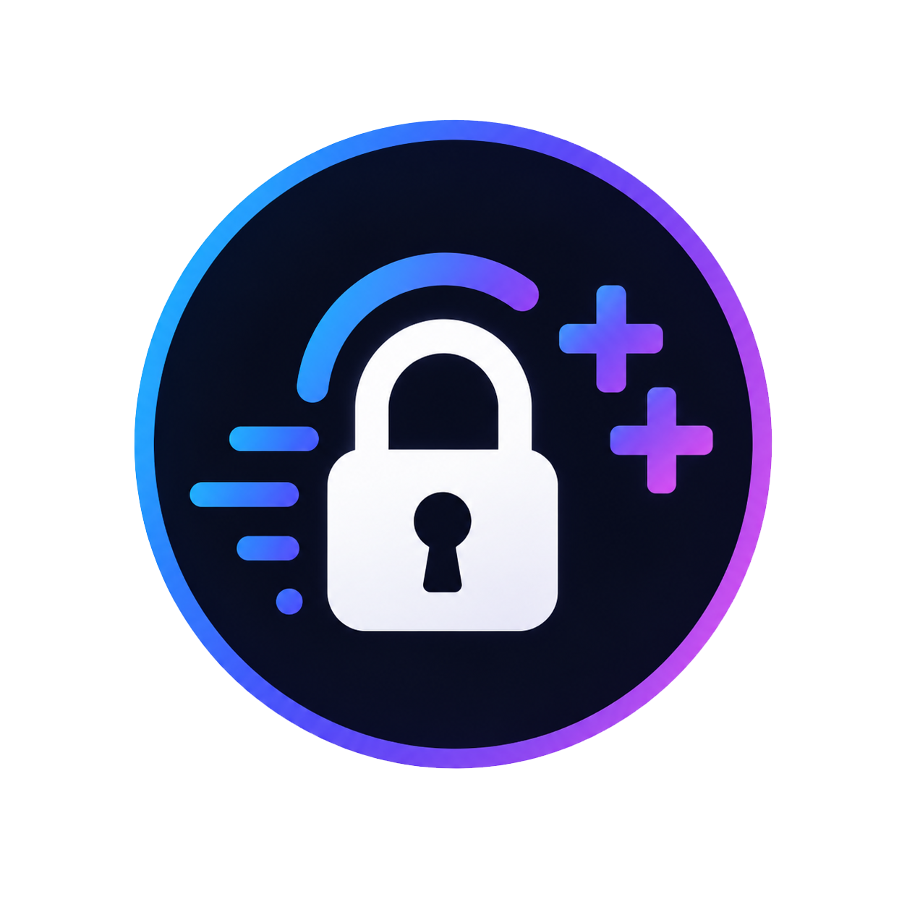
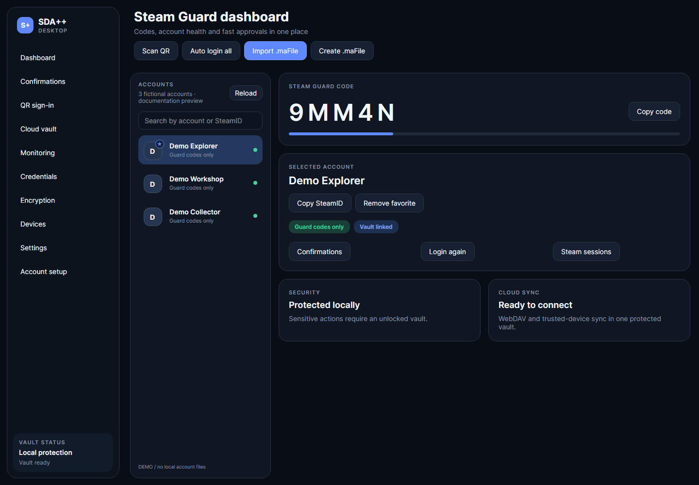
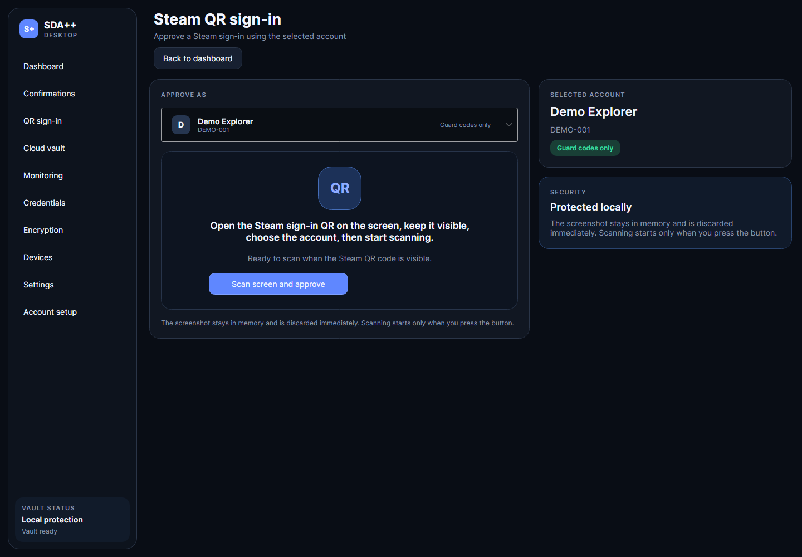
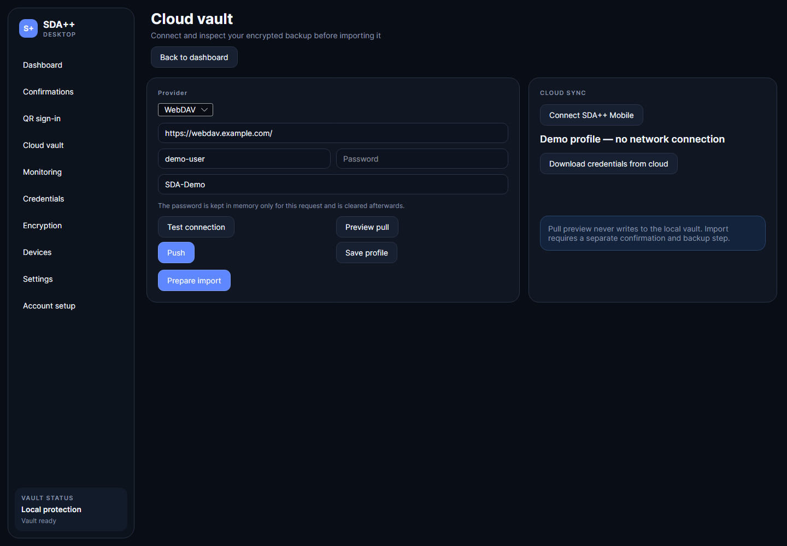
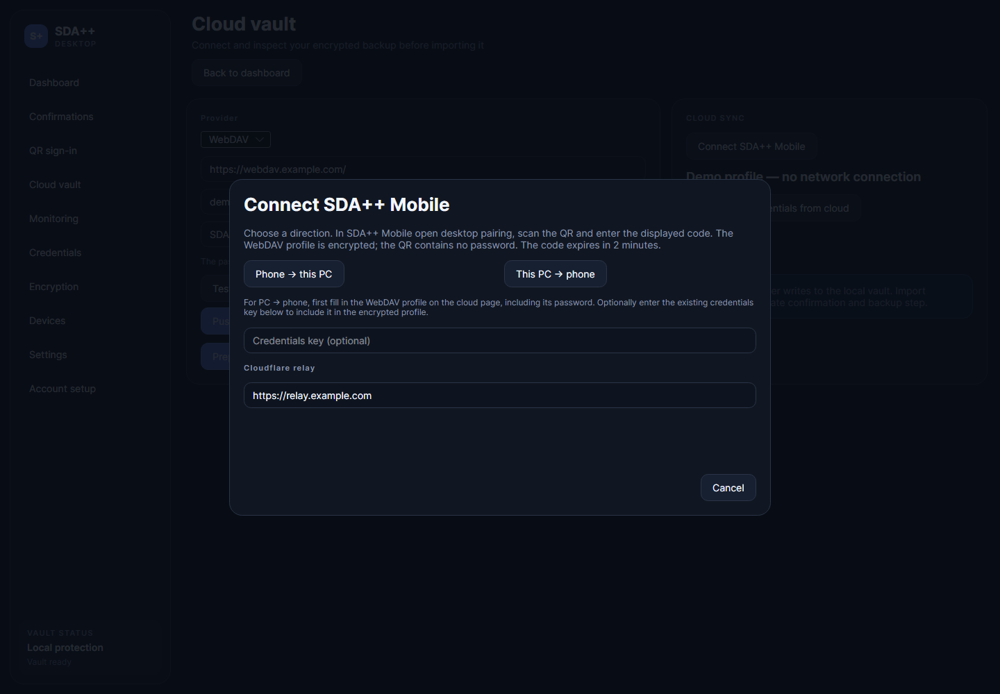
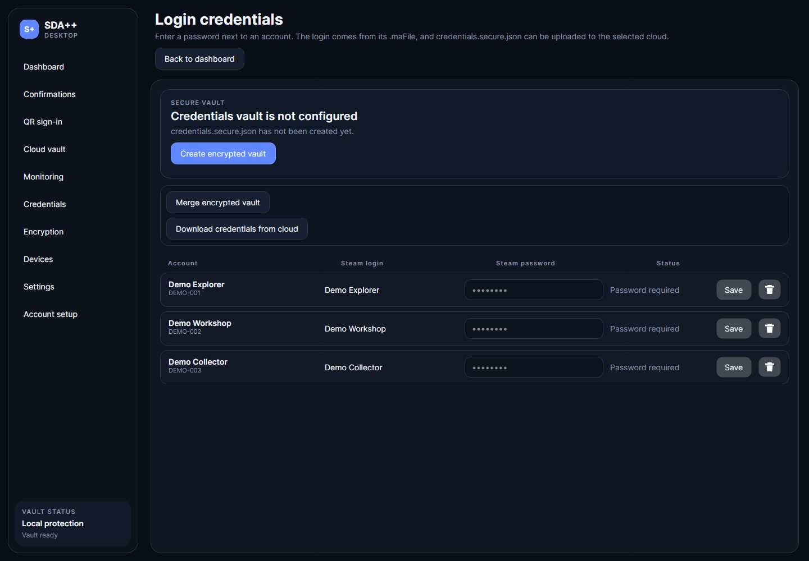
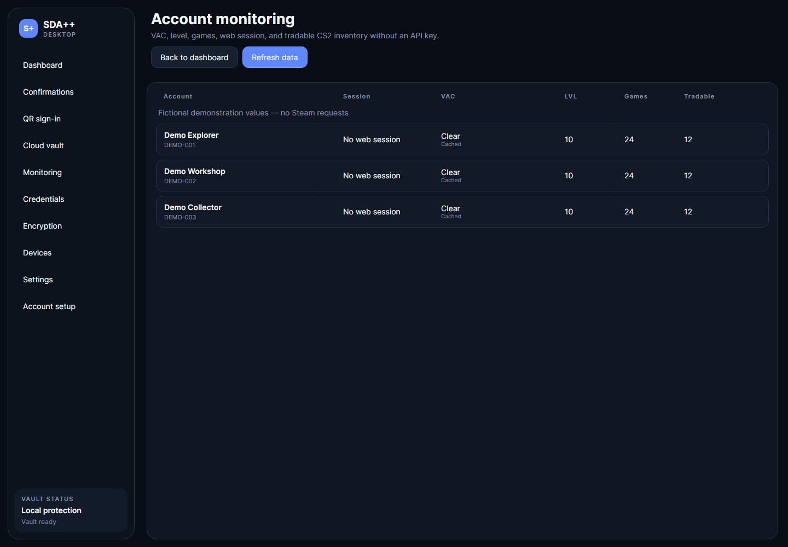
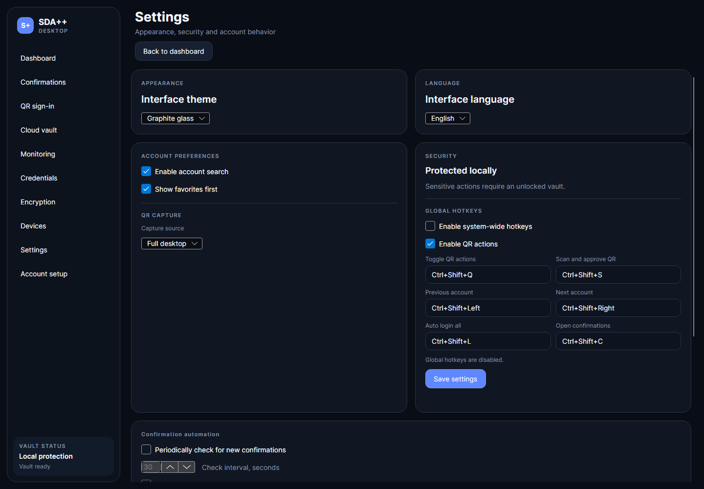

# SDA++ — Avalonia Desktop

<p align="center"></p>

**Steam Guard, account management, confirmations and encrypted cloud backups in an Avalonia desktop interface.**

[Download Windows x64](https://github.com/ManeWreck/SDA-plus-plus/releases/latest) · [Русское описание](README.ru.md) · [Build from source](open-source/README.md) · [Release notes](docs/releases/1.7.4.md)

The main application is now **Avalonia 1.7.4**. Windows x64 is the supported release target. The earlier WinForms UI remains in the source tree for reference and compatibility work; it is no longer the default download.



> All screenshots render the actual application views with fictional demonstration data. They contain no real Steam accounts, passwords, vault keys or personal settings. The screenshot tool does not read a user profile or contact Steam/cloud services.

## What you can do

| Area | Features |
| --- | --- |
| Steam Guard | View and copy codes; search accounts; mark favorites; import existing .maFile backups. |
| Account setup | Choose cloud setup, local SDA/SDA++ folder import, QR sign-in or trusted-device setup. An authenticator enrollment wizard is also included. |
| Confirmations | Review confirmations with their originating account; inspect details before accepting or rejecting. Optional periodic checking is configurable. |
| QR sign-in | Scan a Steam login QR displayed on your screen and approve it using the selected account. |
| Credentials & recovery | Keep saved logins in a separate encrypted credentials vault; import or download an existing encrypted file; run batch re-login with saved credentials. |
| Cloud backups | WebDAV, S3-compatible storage, Dropbox, OneDrive and Google Drive adapters; preview and validate a restore before local changes. OAuth providers need their own client configuration. |
| Mobile connection | Transfer a WebDAV profile **Phone → PC** or **PC → Phone** using the Mobile v2 protocol, a temporary QR and a separate one-time code. |
| Monitoring | Inspect session state, visible VAC/ban information, level, games and tradable inventory status; private and unavailable data are shown separately. |
| Preferences | English/Russian interface, three dark themes, account search, favorites and configurable Windows global hotkeys. |
| Navigation | Mouse4/Mouse5 or Alt+Left/Right move through page history. No extra arrow toolbar. |

## QR sign-in

Open a Steam login QR on your screen, choose the account in SDA++, then start scanning. Screen capture is user-triggered and processed in memory.



## Cloud backups and Mobile

Set up a cloud profile, test the connection and preview the remote vault before importing. Downloaded account data is validated before committing a restore. WebDAV reads have bounded timeouts and a limited retry for transient failures; writes are not automatically retried.



**Connect SDA++ Mobile** offers both transfer directions. Pairing uses ephemeral P-256 ECDH, HKDF-SHA256 and AES-GCM. The QR contains connection information, public keys and one-time relay tokens, not the WebDAV password. An optional credentials-vault key may be included **inside the encrypted payload** when explicitly supplied. The code/session lasts two minutes. LAN is attempted alongside the relay path; received profiles require confirmation before applying.



Pairing transfers cloud settings, not the account files themselves and not trusted-device privileges. After applying the profile, use cloud preview/import to restore accounts. Cloud passwords are session-only in this Avalonia flow; saving a profile does not write its password into the preferences JSON.

## Encrypted login credentials

An existing `credentials.secure.json` can be downloaded from the selected cloud. You still need its original encryption key. If the local file is missing, batch re-login starts the download/import flow instead of silently creating a replacement. Keep the credentials key separately from the encrypted file.



## Monitoring and preferences





## Install or migrate

1. Download `SDAplusplus-Avalonia-1.7.4-win-x64.zip` from [Releases](https://github.com/ManeWreck/SDA-plus-plus/releases/latest).
2. Extract the entire archive into a new folder, then run `SDA++.exe`. The Windows x64 package includes .NET; no separate runtime install is needed.
3. Keep a backup of your existing SDA folder. Choose **Account setup → Import an SDA / SDA++ folder** or configure cloud restore.
4. Encrypted account files need their original password. The credentials vault uses its own key. Local folder import does not copy machine-specific secrets or replace an existing account set.

The source repository no longer ships an old executable under `portable-exe`. Obtain builds from Releases.

## Security and current limits

- Never publish .maFile files, manifests, credentials files, tokens, cloud passwords or recovery codes. CI checks tracked files and release packages for sensitive filenames.
- Preserve your original authenticator recovery information and backups. This application is not affiliated with Valve.
- Authenticator enrollment, physical Android pairing and live provider behavior still require environment-specific testing. Protocol tests are not a guarantee that every phone/network/provider combination has been tested.
- The Devices area and signed-command components are under active development. Full cross-device command execution/result delivery is not represented as complete.
- Avalonia is cross-platform technology, but this release still uses Windows-specific screen capture, hotkeys and key protection. Linux/macOS release parity is not claimed.

## Development

```powershell
dotnet test open-source/SDAPlusPlus.Core.Tests/SDAPlusPlus.Core.Tests.csproj -c Release
dotnet run --project open-source/SDAPlusPlus.Desktop/SDAPlusPlus.Desktop.csproj -c Release
```

The release workflow tests Core, builds Avalonia and publishes an autonomous Windows x64 archive. Reproduce the privacy-safe screenshots with:

```powershell
dotnet run --project tools/SDAPlusPlus.Screenshots -c Release
```

See [source layout](open-source/README.md), [screenshot provenance](docs/screenshots/README.md) and [1.7.4 verification notes](docs/releases/1.7.4.md).

Based on the original Steam Desktop Authenticator and SteamAuth projects. See [LICENSE](LICENSE) and the bundled library notices.
