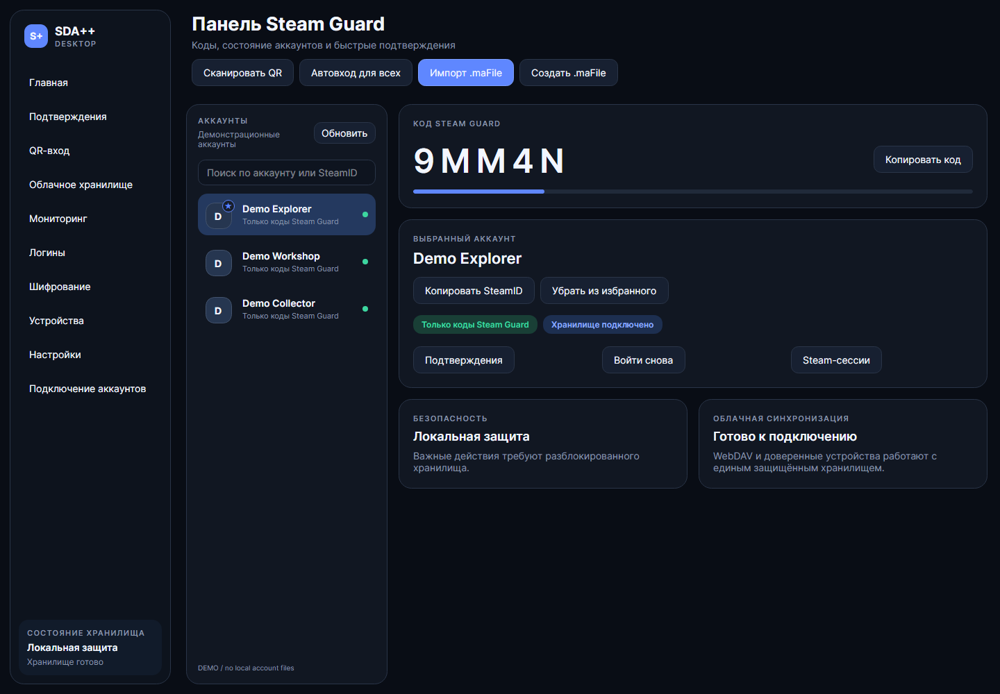

# SDA++ — Avalonia Desktop

**Основная версия SDA++ теперь использует Avalonia.** Windows x64 — поддерживаемая платформа выпуска 1.7.4. WinForms сохранена в исходниках как legacy.

[Скачать для Windows](https://github.com/ManeWreck/SDA-plus-plus/releases/latest) · [English](README.md) · [Исходники Avalonia](open-source/SDAPlusPlus.Desktop)

Все скриншоты получены из настоящих представлений Avalonia на вымышленных данных. Реальные аккаунты, пароли, ключи и личные настройки не использовались.

## Возможности

- Коды Steam Guard, копирование, поиск аккаунтов и избранное.
- Импорт отдельных .maFile и существующей папки SDA/SDA++; мастер первого запуска.
- Подтверждения Steam с указанием исходного аккаунта и просмотром деталей.
- QR-вход: сканирование видимого на экране кода Steam и подтверждение выбранным аккаунтом.
- Отдельное зашифрованное хранилище логинов, скачивание credentials.secure.json и массовый повторный вход.
- Облачные адаптеры WebDAV, S3, Dropbox, OneDrive и Google Drive; предварительный просмотр и проверка восстановления.
- Передача профиля WebDAV телефон → ПК и ПК → телефон через временный QR и отдельный одноразовый код.
- Мониторинг сессий, видимых банов, уровня, игр и доступного для обмена инвентаря.
- Русский и английский интерфейс, три тёмные темы и настраиваемые горячие клавиши.
- Навигация назад/вперёд через Mouse4/Mouse5 или Alt+←/→.

## Облако и Mobile

Передаётся зашифрованный профиль WebDAV. В QR нет пароля. При явном указании ключ логинов можно включить внутрь зашифрованного сообщения. Сеанс действует две минуты. Полученный профиль применяется после подтверждения; аккаунты затем загружаются отдельно через облачный импорт. Такая передача сама по себе не выдаёт права доверенного устройства.

Пароль облака в этом сценарии Avalonia хранится только в памяти сеанса. Для открытия старого файла логинов нужен исходный ключ, для зашифрованных .maFile — исходный пароль.

## Установка

1. Скачайте ZIP из Releases и полностью распакуйте в новую папку.
2. Запустите SDA++.exe. .NET включён в пакет Windows x64.
3. Сохраните резервную копию прежней папки SDA.
4. Откройте «Подключение аккаунтов» и импортируйте локальную папку либо настройте облако.

## Статус

Сборка и 244 Core-теста проверены. Скриншоты автоматически воспроизводятся без чтения личных данных и сетевых запросов. Настоящий Android, регистрация аутентификатора и конкретные облачные подключения требуют проверки в своей среде. Полный цикл удалённых команд доверенных устройств ещё развивается. Linux/macOS не заявлены как готовые платформы этого выпуска.

[Подробности функций и все скриншоты](README.md) · [Примечания к выпуску](docs/releases/1.7.4.md)
